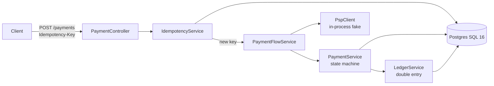

# LedgerGuard: Payment Ledger Service

**LedgerGuard is a payment ledger that never charges twice.** It accepts payment requests, sends them to a payment provider (PSP), and records every movement of money in a double-entry ledger. It is built for the hard part of payments: clients retry, networks time out, and requests race each other. Correctness is measured with tests and a load run, not claimed.

> **Status:** Phase 1 (core ledger and idempotency) is complete. The provider is simulated in-process for now; see the [roadmap](#roadmap).

## Results (Phase 1 load test)

k6 sent **5,000 requests from 50 concurrent virtual users**. 30% of them deliberately retried an earlier idempotency key with the same body, and the fake provider failed 10% of charges.

| Metric | Result |
|---|---|
| Duplicate charges (payments sharing an idempotency key) | **0** |
| Unbalanced ledger transactions | **0** |
| Payments created (unique keys) | 3,500 |
| Retries answered with the saved response (200) | 345 |
| Retries rejected while the original was in flight (409) | 1,155 |
| Unexpected responses (anything other than 200/201/409) | 0 |
| Throughput | ~494 requests/s |
| Latency | median 103 ms, p95 146 ms, **p99 191 ms** |

All 1,500 retries came back as either a replay of the original result or a 409, and none produced a second payment. These numbers come from a single laptop run against local PostgreSQL in Docker.

## Architecture



One Spring Boot service owns all money logic. Code is organized **by feature** (`payment`, `ledger`, `idempotency`, ...), and each feature is layered into controller, service and repository.

## Core design

Every payment follows one rule: **write what you intend to do before you do it, and make every step safe to repeat.**

1. **Idempotency key first.** The `(merchant_id, idem_key)` row is inserted as `IN_PROGRESS`, with an SHA-256 hash of the request body, before any work starts:
   - same key, same body → the saved response is returned (HTTP 200)
   - same key, different body → HTTP 422
   - same key, original still running → HTTP 409
2. **Payment intent before the provider call.** The payment is saved as `CREATED`, then moved to `PENDING`, and both are committed *before* the provider is charged.
3. **State machine.** Only these moves are allowed; every other move is rejected (HTTP 409) and logged:
   ```
   CREATED → PENDING → CAPTURED | FAILED
   CAPTURED → REFUND_PENDING → REFUNDED
   ```
   A `version` column (optimistic locking) stops two workers from moving the same payment at once.
4. **Double-entry ledger.** A capture debits `customer_funds` and credits `merchant_payable`, and a refund posts the reversing entries. Each ledger transaction has at least two entries whose amounts sum to zero, written in the same database transaction as the state change. Balances are always derived from entries, never stored.
5. **Money as integers.** Amounts are `BIGINT` minor units, never floating point.

## API

| Method and path | What it does |
|---|---|
| `POST /payments` | Create and process a payment (requires `Idempotency-Key`) |
| `POST /payments/{id}/refunds` | Full refund of a captured payment (requires its own `Idempotency-Key`) |
| `GET /accounts/{id}/balance` | Balance derived from ledger entries |

Example:
```bash
curl -i -X POST localhost:8080/payments \
  -H "Content-Type: application/json" -H "Idempotency-Key: order-42" \
  -d '{"merchantId":"11111111-1111-1111-1111-111111111111","amount":10000,"currency":"INR"}'
```
A new payment returns **201**, and a replay of the same request returns **200** with the identical body.

Errors come back as `{ timestamp, status, error, message, path }`:

| Status | When |
|---|---|
| 400 | Invalid body, malformed JSON, missing `Idempotency-Key`, bad id |
| 404 | Unknown payment or account |
| 409 | Illegal state transition, request with the same key still in progress, concurrent modification |
| 422 | Idempotency key reused with a different body |

## Running locally

**Prerequisites:** JDK 21, Docker, and [k6](https://k6.io) for the load test.

```bash
# 1. Start Postgres SQL
docker compose -f deploy/docker-compose.yml up -d

# 2. Start the service (Flyway creates the schema and seeds the ledger accounts)
cd ledger-service
./gradlew bootRun

# 3. Check it is up
curl localhost:8080/actuator/health
```

The database connection comes from the environment variables `DB_URL`, `DB_USER` and `DB_PASSWORD`, with local defaults in `application.yaml`. The fake provider's failure rate is set by `psp.fake.failure-rate` (default `0.0`), for example `PSP_FAKE_FAILURE_RATE=0.1 ./gradlew bootRun`.

## Tests

```bash
cd ledger-service
./gradlew test   # needs Docker running (Testcontainers)
```

- **Unit tests:** every one of the 36 state-transition pairs, and the ledger balancing rules.
- **Integration tests (Testcontainers, real PostgreSQL):**
  - the same key sent twice returns the same payment
  - the same key with a different body returns 422
  - 50 parallel requests with one key create exactly one payment

The same tests run in GitHub Actions on every push.

### Load test and correctness check

```bash
k6 run -e RUN_ID=$(date +%s) load/duplicates.js
```
Then confirm that both queries return **0 rows**:
```bash
docker compose -f deploy/docker-compose.yml exec postgres psql -U ledger -d ledger -c "  
-- no idempotency key produced more than one payment
SELECT idem_key, COUNT(*) FROM payments GROUP BY idem_key HAVING COUNT(*) > 1;
-- every ledger transaction balances
SELECT transaction_id FROM ledger_entries GROUP BY transaction_id HAVING SUM(amount) <> 0;"
```

## Known limitations (Phase 1)

- **The provider is an in-process fake** with a configurable failure rate. A separate, unreliable provider simulator arrives in Phase 2.
- **A key can be stuck in `IN_PROGRESS`.** If a request fails unexpectedly after its key is recorded, the key stays `IN_PROGRESS` and later retries get 409. This is deliberate: when the outcome is unknown, refusing is safer than risking a second charge. Recovery comes with the stuck-payment sweeper and reconciliation in Phase 3.
- **A failed provider refund leaves the payment in `REFUND_PENDING`.** It cannot be retried yet.
- **Full refunds only**, and INR only. The currency check is a placeholder for later extension.

## Roadmap

| Phase | Scope | Status |
|---|---|---|
| 0 | Project setup, PostgreSQL in Docker, CI | Done |
| 1 | Ledger, idempotency, state machine, Testcontainers, k6 gate | Done |
| 2 | Separate PSP simulator, signed webhooks, transactional outbox to Kafka | Planned |
| 3 | Daily reconciliation against the settlement file, stuck-payment sweeper | Planned |
| 4 | Chaos suite (Toxiproxy, process kills, broker restarts), invariant checker as a CI gate | Planned |
| 5 | Metrics and tracing, Grafana, Kubernetes with Helm, React dashboard | Planned |

## Tech stack

Java 21, Spring Boot 4, Spring Data JPA, PostgreSQL 16, Flyway, Lombok, JUnit 5, Testcontainers, k6, Docker, GitHub Actions.

## Repository layout

```
ledgerguard/
├── ledger-service/      # Spring Boot app: API, state machine, ledger, idempotency
├── load/                # k6 scripts
├── deploy/              # docker-compose.yml
├── docs/
├── psp-simulator/       # Phase 2
├── chaos/               # Phase 4
├── dashboard/           # Phase 5
└── .github/workflows/   # CI
```